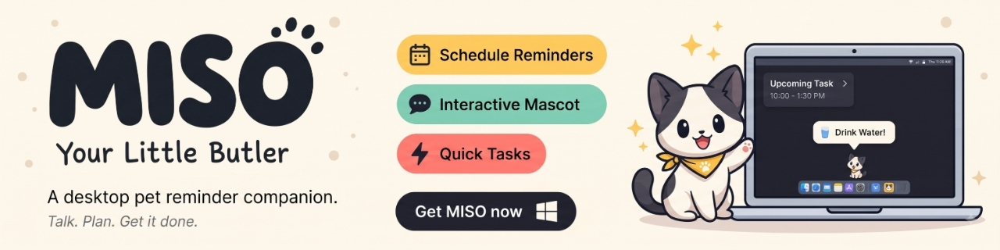

<div align="center">
  <h1>MISO — Your Little Butler</h1>
  
  <p><strong>A little company on your desktop. A little help remembering what matters.</strong></p>
  <p>
    <a href="https://github.com/itsmeabirmohanta/miso-desktop-pet/releases/latest"></a>
    <a href="https://github.com/itsmeabirmohanta/miso-desktop-pet/actions/workflows/check.yml"></a>
    
    
  </p>
  <p>
    <a href="https://github.com/itsmeabirmohanta/miso-desktop-pet/releases/latest/download/MISO-Setup.exe"><strong>Download for Windows</strong></a>
    &nbsp; · &nbsp;
    <a href="https://github.com/itsmeabirmohanta/miso-desktop-pet/releases/latest">Release notes</a>
    &nbsp; · &nbsp;
    <a href="docs/USER-GUIDE.md">User guide</a>
  </p>
</div>

---

MISO is a small, draggable desktop cat that helps you keep up with Google Calendar meetings, tasks, reminders, and important dates. Click your companion, answer a few short prompts, and get back to your day. Calendar features work with **AI switched off** and require no AI key.

## Meet your butler

| A little help                     | How MISO helps                                                                                        |
| --------------------------------- | ----------------------------------------------------------------------------------------------------- |
| **Remember the day**              | Add tasks, timed reminders, birthdays, and yearly important dates.                                    |
| **Bring your calendars together** | Connect multiple Google accounts and choose which calendars to watch.                                 |
| **Stay in the flow**              | Use compact, centered prompts instead of opening the full settings panel.                             |
| **See what's next**               | Browse a seven-day agenda, view event details, review edits or deletions, and open Google Calendar.   |
| **Make room for your cat**        | Drag MISO anywhere on your screen. Its name appears on hover; hovering returns it to rest.            |
| **Add AI when you want it**       | Enable natural-language commands with a supported provider, a compatible endpoint, or a local server. |

<table>
  <tr>
    <td align="center"><br><strong>Resting</strong></td>
    <td align="center"><br><strong>Happy</strong></td>
    <td align="center"><br><strong>Sleeping</strong></td>
    <td align="center"><br><strong>Aye aye, boss</strong></td>
  </tr>
</table>

While idle, MISO changes pose every 15 seconds. Rotation pauses during interactions and respects reduced-motion preferences. The interface uses warm cream, charcoal, and butter-yellow accents with locally bundled Baloo 2 and Inter fonts. See the [brand guide](docs/UI-BRANDING.md).

## Start in three steps

1. **Install:** download [MISO-Setup.exe](https://github.com/itsmeabirmohanta/miso-desktop-pet/releases/latest/download/MISO-Setup.exe), run it, and open **MISO** from Start after clicking Finish. Node.js is not needed.
2. **Connect:** sign in to your own Google account in your browser. Add more accounts and select your calendars in Settings.
3. **Ask:** click the cat or press **Ctrl+Alt+B** to add a reminder, task, important date, or view your calendar. Change the shortcut in Settings.

| Control                             | Action                                                    |
| ----------------------------------- | --------------------------------------------------------- |
| Click MISO                          | Open the quick-help dialog.                               |
| Hold the left mouse button and drag | Move the cat.                                             |
| Hover                               | Show the name and return to the resting pose.             |
| Ctrl+Alt+B                          | Open quick help; the combination is configurable.         |
| Settings button or tray menu        | Manage accounts, calendars, preferences, and optional AI. |

**Distribution status:** Windows x64 is the verified installer target. The current installer is unsigned and may show a Windows reputation warning. The publisher-configured release includes default Google sign-in configuration; Google's consent warning remains until the OAuth project completes the required verification. Download availability and Google approval are separate. See the [installation and troubleshooting guide](docs/USER-GUIDE.md).

For a checksum, download [MISO-Setup.exe.sha256](https://github.com/itsmeabirmohanta/miso-desktop-pet/releases/latest/download/MISO-Setup.exe.sha256) from the release. Share the original installer; each user connects their own accounts. The public GitHub release includes the installer, checksum, and installation guide.

## Your data

- **Stored on your device:** accounts, calendar cache, preferences, refresh tokens, and AI keys use operating-system-backed local encryption.
- **AI is your choice:** it is off by default. When enabled, typed commands and clarification context go to the provider or local server you select.
- **No analytics or crash-upload service is configured.** Calendar synchronization communicates with Google.
- **Separate installations, separate data:** the installer excludes personal profiles, calendar data, private keys, and test screenshots.
- **Google app configuration is public-client configuration:** the bundled Desktop OAuth client ID and client secret are hidden in the settings UI but remain extractable from the installer. They are separate from personal account tokens.

OS encryption does not protect an unlocked device from malware running as its user. Read the [security and shipping details](docs/SECURITY-AND-SHIPPING.md), [publication review](docs/PUBLICATION-REVIEW.md), or [report a security issue privately](SECURITY.md).

## Build and customize

<details>
<summary><strong>Run from source</strong></summary>

Use Node.js **22.12 or newer**, npm, and a desktop session.

```sh
git clone https://github.com/itsmeabirmohanta/miso-desktop-pet.git
cd miso-desktop-pet
npm ci
npm start
```

Source builds need a Google **Desktop app** OAuth client with Calendar API enabled. Enter it under **Setup / credentials → Advanced developer configuration**, or set `BUTLER_GOOGLE_CLIENT_ID` and `BUTLER_GOOGLE_CLIENT_SECRET` in your shell. Scripts do not automatically load `.env` files. [.env.example](.env.example) contains empty variable examples.

Development configuration is not automatically embedded in a release. Connected accounts must be removed before changing OAuth clients; **Restore default** is available when a build includes publisher configuration.

</details>

<details>
<summary><strong>Verify and package</strong></summary>

```sh
npm run check             # TypeScript, offline tests, development build
npm run smoke             # Electron workflows with isolated synthetic accounts
npm run format:check
npm run dist              # Clean release build, installer, and release audits
npm run smoke:packaged    # Windows archive/fuse audit and fresh-profile startup
node scripts/verify-packaged.mjs --safe-mode
```

Installers are generated as `release/MISO Setup <version>.exe`, alongside a SHA-256 checksum. macOS/Linux packaging targets exist but have not been verified here. CI uploads Windows build artifacts; it does not automatically publish a GitHub release.

For a configured publisher build, supply `BUTLER_PUBLIC_GOOGLE_CLIENT_ID` and `BUTLER_PUBLIC_GOOGLE_CLIENT_SECRET`. To explicitly reuse the Desktop app configuration saved in your local MISO profile, run `npm run dist:configured`. This exports only the app's OAuth client configuration into the build environment; account tokens, AI keys, and calendar data are excluded.

Use only Desktop OAuth configuration for bundled defaults. Never embed personal account tokens, AI keys, service-account private keys, or confidential server credentials. Publisher builds in CI require default Google configuration before their installers can be uploaded; pull-request artifacts are labeled test builds.

See [verification results](docs/VERIFICATION.md) and the [manual acceptance checklist](docs/MANUAL_TESTS.md).

</details>

<details>
<summary><strong>Use your own artwork</strong></summary>

Edit `src/assets`; generated files in `dist` are rebuilt automatically.

```text
src/assets/
  branding/        logo.svg / logo.png / logo.webp, icon.ico, icon.png, tray.png
  mascot/
    idle/          mascot.svg / mascot.png / mascot.webp / mascot.gif
    walk/
    sleep/
    alert/
    happy/
    thinking/
    wink/
```

Each pose uses the same `mascot` base name. Build-time priority is WebP, PNG, GIF, then SVG. Missing poses use the original cat as a fallback. Keep transparent canvases consistent; the build preserves supplied artwork and generates the asset manifest. See the [artwork guide](src/assets/README.md).

</details>

## Explore further

| For users                                                                              | For contributors                           |
| -------------------------------------------------------------------------------------- | ------------------------------------------ |
| [Installation and troubleshooting](docs/USER-GUIDE.md)                                 | [Contributing](CONTRIBUTING.md)            |
| [Latest release](https://github.com/itsmeabirmohanta/miso-desktop-pet/releases/latest) | [Artwork guide](src/assets/README.md)      |
| [Privacy and security](docs/SECURITY-AND-SHIPPING.md)                                  | [Optimization notes](docs/OPTIMIZATION.md) |
| [Security reporting](SECURITY.md)                                                      | [Brand styling](docs/UI-BRANDING.md)       |

No project-wide license has been selected. Bundled fonts retain their respective [Baloo 2](src/assets/fonts/Baloo2-OFL.txt) and [Inter](src/assets/fonts/Inter-OFL.txt) licenses.

## Help MISO reach more desktops

Save the repository with a star, watch releases for updates, or share the [Windows download](https://github.com/itsmeabirmohanta/miso-desktop-pet/releases/latest/download/MISO-Setup.exe) with someone who would enjoy a desktop companion. Have a question or an idea? Join [Discussions](https://github.com/itsmeabirmohanta/miso-desktop-pet/discussions). Report reproducible bugs and request features through the [issue forms](https://github.com/itsmeabirmohanta/miso-desktop-pet/issues/new/choose).

See [shareable links and a short product introduction](docs/SHARING.md).
